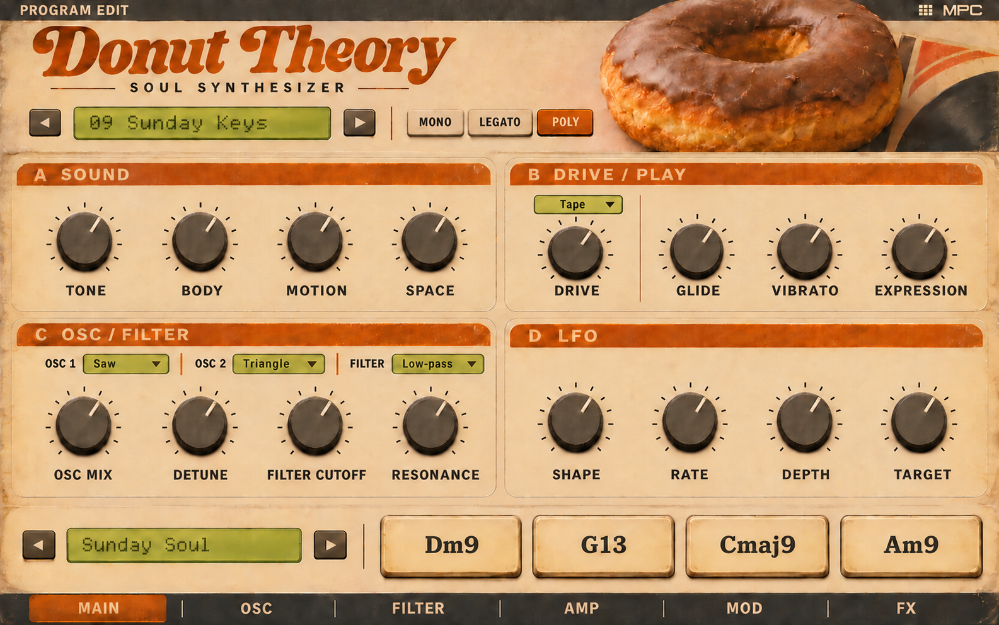

# Donut Theory — 디자인 기준

## 승인된 기준

사용자가 최종적으로 좋다고 확인한 화면은 아래 이미지다. **B DRIVE / PLAY, 맨 왼쪽 DRIVE, 그 위 Tape 선택기와 구분선**이 있는 버전을 기준으로 한다.

- 자산: `design/main-approved.png`
- 승인 기록일: 2026-11-13 (Asia/Seoul).
- 제작: 이 대화의 이미지 생성 도구. 저장소 안에 복사해 보존했다.
- 용도: 구현을 위한 시각 기준. 실제 MPC 캡처, 완성 스킨, 개별 knob filmstrip이 아니다.
- 앞선 HTML/CSS 시안들은 탐색안이며 이 이미지보다 우선하지 않는다.

## 시각 방향

- 따뜻한 소울·힙합, 오래된 레코드 작업실, 빈티지 샘플러.
- 크림/오트밀 패널, 바랜 갈색·주황색, 올리브 LCD, 짙은 회색 리브 노브.
- Donut Theory 이름은 크고 개성 있는 빈티지 세리프 타이포그래피.
- 도넛은 실제 빵의 두께·구멍·초콜릿 질감이 읽히는 입체적 이미지다. 광택 과다, 만화 스프링클, 단순 원형 CSS 도넛은 채택하지 않는다.
- 도넛과 레코드 슬리브를 헤더에 배치한다. 도넛이 헤더 경계에 걸치는 입체감을 허용하되 컨트롤·호스트 조작을 덮지 않는다.
- 낡은 질감은 장식 면에 사용하고 라벨·값은 선명하게 유지한다.
- 장식을 늘려 조작부를 압박하거나 전체를 새로 바꾸지 않는다.

## 화면 구조

- 상단: 이름·도넛·음색 프리셋 좌우 이동·Mono/Legato/Poly.
- 가운데: 2열 × 2행의 Q-Link 그룹. A SOUND, B DRIVE / PLAY, C OSC / FILTER, D LFO.
- 하단: 코드 진행 프리셋 좌우 이동과 코드 패드 4개.
- 음색과 코드 프리셋 선택기는 왼쪽에 조밀하게 배치한다. 선택 영역을 불필요하게 넓히지 않는다.
- 큰 초기 노브에서 약 10%, 이후 약 5% 축소한 시각적 비율이 승인됐다. 실제 픽셀 수를 이 비율로 단정하지 말고 승인 이미지와 터치 크기를 기준으로 구현한다.

## 사용자 인식과 배치 규칙

1. 종류 선택기·관련 노브·현재 값은 한 덩어리로 보이게 한다.
2. DRIVE 종류는 DRIVE 바로 위. DRIVE는 B 그룹 첫 번째, GLIDE/VIBRATO/EXPRESSION은 그 오른쪽이며 구분선을 둔다.
3. 필터 종류는 FILTER CUTOFF·RESONANCE와 연결되어 보이도록 배치한다. 오실레이터 선택기도 관련 제어와 묶는다.
4. 그룹 제목과 컨트롤 라벨 사이 여백을 확보한다. 제목 바로 밑에 글씨를 붙이지 않는다.
5. Q-Link 그룹별 네 컨트롤은 명확한 블록이어야 한다. 포커스 사각형이 관련 없는 요소를 감싸지 않게 한다.
6. 파형·타겟·단위가 현재 상태로 읽혀야 한다. 노브 이름만 보이는 것으로 완료하지 않는다.
7. 프리셋은 이전/다음 버튼과 목록 선택 둘 다 제공한다. 어떤 종류의 프리셋을 바꾸는지 분명하게 표시한다.
8. 기본 매크로를 조용히 삭제하지 않는다. 배치 변경 시 기능 매핑과 문서를 함께 갱신한다.

## SDK 화면 제약

초기 분석의 `docs/ui-reference.md` 기준:

| 영역 | 크기/위치 |
|---|---|
| 전체 | 1280 × 800, 16:10 |
| 플러그인 탭 콘텐츠 | 1280 × 628 |
| 콘텐츠 시작 | 전체 화면 y=110 |
| 하단 호스트 영역 | 나머지 62px |

- 승인 이미지는 미술 콘셉트여서 호스트 바 높이와 콘텐츠 비율이 SDK 좌표에 정확하게 일치하지 않는다. 이미지 전체를 스킨 배경으로 그대로 붙이지 않는다.
- 도넛이 넘는 경계는 플러그인 내부 장식 경계로 처리한다. 실제 MPC 호스트 영역을 임의로 덮지 않는다.
- Q-Link 사이드바가 오른쪽을 덮을 수 있다. SDK의 qlinkBoundsData와 그룹 매핑을 검토하고 실기기에서 확인한다.
- 기본 생성기의 4×4 슬롯 배치만으로 승인 디자인을 그대로 구현할 수 있다고 가정하지 않는다. 필요하면 커스텀 skins/와 실제 이미지·filmstrip을 제작한다.
- MPC 모델에 따른 표시/조작을 확인한다. 호스트 UI와 MPC 표시는 소프트웨어가 그려주는 영역이며 플러그인 자산에 복제하지 않는다.

## 이미지에서 보완해야 할 기능적 요소

- 각 노브의 현재 값과 단위: 컷오프 Hz/kHz, Detune cent, Glide ms 등.
- LFO Shape/Target의 선택값, Rate의 Hz/템포 분할 및 동기화 상태.
- NOTES/CHORDS/SPLIT 접근, 글라이드 조건, 코드 편집 화면 진입.
- 마스터 볼륨, 상세 BEND 범위, FX 출력 보정·Dry/Wet 접근.
- 포커스/선택/비활성 표시, 대비, 실제 터치 영역.
- 코드 패드의 재생 상태와 편집 상태 구분. 실제 발음 여부는 SDK 확인 결과에 따른다.

## 자산 제작 및 검증

승인 이미지를 참고해 배경, 로고, 도넛, 노브 filmstrip, 버튼 등을 별도 제작한다. 사용한 외부 자산·폰트의 출처와 라이선스를 기록한다. 디자인 파일을 특정 로컬 사용자 경로나 임시 폴더에만 남기지 않는다.

실제 1280×628 콘텐츠에서 텍스트·노브·선택기·코드 패드가 겹치지 않는지 확인하고, Q-Link 포커스와 값 표시를 검증한다. 정적 이미지의 미관만으로 실제 사용성을 검증했다고 보고하지 않는다.
