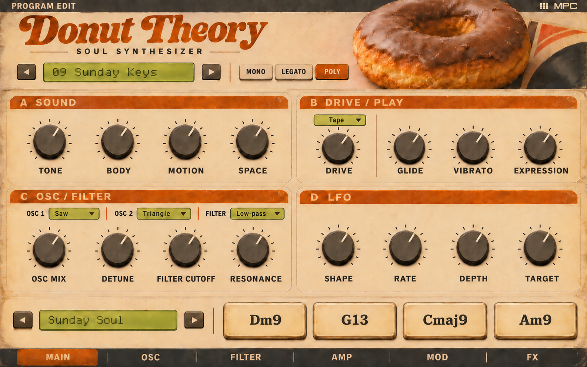
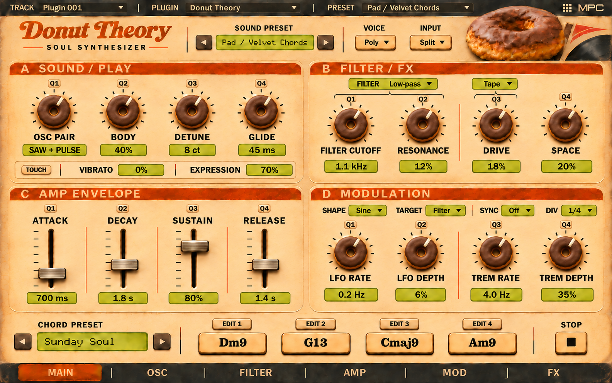

# Donut Theory — 디자인 기준

## 현재 적용 기준 — 1.2.2

**정식 배포 완료, 2026-11-15.** [인계·재개 기준](handoff.md)과 최신 spec.md의 매핑을 먼저 적용한다. 아래 초기 승인 이미지/변경 일지는 미술 방향과 결정 이력이며 초기 B DRIVE / PLAY 배치나 과거 ‘아직 배포 전’ 상태를 현재 사양으로 해석하지 않는다.

현재는 A Sound/Play, B Amp Envelope, C Filter/LFO, D FX/Tremolo이며 갈색 헤더/크림 본체/도넛 노브/올리브 LCD와 가로형 도넛·레코드 장식을 유지한다. 실제 [MAIN](../../../../site/public/images/donut-theory-main-1.2.2.webp) / [CHORD](../../../../site/public/images/donut-theory-chords-1.2.2.webp) / [목록](../../../../site/public/images/donut-theory-browser-1.2.2.webp)이 현재 구현의 시각 기준이다. 수동 패드 위치 표시·선택 UI는1.2.2에서 제거했고 MIDI/LEARN은 유지한다. MAIN↔CHORD 직접 터치 전환은 사용자 확인까지 완료했다. 콘셉트·오프라인 렌더·실제 캡처를 구분한다.

## 초기 승인 기준과 변경 이력

사용자가 최종적으로 좋다고 확인한 화면은 아래 이미지다. **B DRIVE / PLAY, 맨 왼쪽 DRIVE, 그 위 Tape 선택기와 구분선**이 있는 버전을 기준으로 한다.

- 자산: `design/main-approved.png`
- 승인 기록일: 2026-11-13 (Asia/Seoul).
- 제작: 이 대화의 이미지 생성 도구. 저장소 안에 복사해 보존했다.
- 용도: 구현을 위한 시각 기준. 실제 MPC 캡처, 완성 스킨, 개별 knob filmstrip이 아니다.
- 앞선 HTML/CSS 시안들은 탐색안이며 이 이미지보다 우선하지 않는다.

## 시각 방향

- 따뜻한 소울·힙합, 오래된 레코드 작업실, 빈티지 샘플러.
- 크림/오트밀 패널, 바랜 갈색·주황색, 올리브 LCD, 짙은 회색 리브 노브.
- Donut Theory 이름은 크고 개성 있는 빈티지 세리프 타이포그래피.
- 도넛은 실제 빵의 두께·구멍·초콜릿 질감이 읽히는 입체적 이미지다. 광택 과다, 만화 스프링클, 단순 원형 CSS 도넛은 채택하지 않는다.
- 도넛과 레코드 슬리브를 헤더에 배치한다. 도넛이 헤더 경계에 걸치는 입체감을 허용하되 컨트롤·호스트 조작을 덮지 않는다.
- 낡은 질감은 장식 면에 사용하고 라벨·값은 선명하게 유지한다.
- 장식을 늘려 조작부를 압박하거나 전체를 새로 바꾸지 않는다.

## 화면 구조

- 상단: 이름·도넛·음색 프리셋 좌우 이동·Mono/Legato/Poly.
- 가운데: 2열 × 2행의 Q-Link 그룹. A SOUND, B DRIVE / PLAY, C OSC / FILTER, D LFO.
- 하단: 코드 진행 프리셋 좌우 이동과 코드 패드 4개.
- 음색과 코드 프리셋 선택기는 왼쪽에 조밀하게 배치한다. 선택 영역을 불필요하게 넓히지 않는다.
- 큰 초기 노브에서 약 10%, 이후 약 5% 축소한 시각적 비율이 승인됐다. 실제 픽셀 수를 이 비율로 단정하지 말고 승인 이미지와 터치 크기를 기준으로 구현한다.

## 사용자 인식과 배치 규칙

1. 종류 선택기·관련 노브·현재 값은 한 덩어리로 보이게 한다.
2. DRIVE 종류는 DRIVE 바로 위. DRIVE는 B 그룹 첫 번째, GLIDE/VIBRATO/EXPRESSION은 그 오른쪽이며 구분선을 둔다.
3. 필터 종류는 FILTER CUTOFF·RESONANCE와 연결되어 보이도록 배치한다. 오실레이터 선택기도 관련 제어와 묶는다.
4. 그룹 제목과 컨트롤 라벨 사이 여백을 확보한다. 제목 바로 밑에 글씨를 붙이지 않는다.
5. Q-Link 그룹별 네 컨트롤은 명확한 블록이어야 한다. 포커스 사각형이 관련 없는 요소를 감싸지 않게 한다.
6. 파형·타겟·단위가 현재 상태로 읽혀야 한다. 노브 이름만 보이는 것으로 완료하지 않는다.
7. 프리셋은 이전/다음 버튼과 목록 선택 둘 다 제공한다. 어떤 종류의 프리셋을 바꾸는지 분명하게 표시한다.
8. 기본 매크로를 조용히 삭제하지 않는다. 배치 변경 시 기능 매핑과 문서를 함께 갱신한다.

## SDK 화면 제약

초기 분석의 `docs/ui-reference.md` 기준:

| 영역 | 크기/위치 |
|---|---|
| 전체 | 1280 × 800, 16:10 |
| 플러그인 탭 콘텐츠 | 1280 × 628 |
| 콘텐츠 시작 | 전체 화면 y=110 |
| 하단 호스트 영역 | 나머지 62px |

- 승인 이미지는 미술 콘셉트여서 호스트 바 높이와 콘텐츠 비율이 SDK 좌표에 정확하게 일치하지 않는다. 이미지 전체를 스킨 배경으로 그대로 붙이지 않는다.
- 도넛이 넘는 경계는 플러그인 내부 장식 경계로 처리한다. 실제 MPC 호스트 영역을 임의로 덮지 않는다.
- Q-Link 사이드바가 오른쪽을 덮을 수 있다. SDK의 qlinkBoundsData와 그룹 매핑을 검토하고 실기기에서 확인한다.
- 기본 생성기의 4×4 슬롯 배치만으로 승인 디자인을 그대로 구현할 수 있다고 가정하지 않는다. 필요하면 커스텀 skins/와 실제 이미지·filmstrip을 제작한다.
- MPC 모델에 따른 표시/조작을 확인한다. 호스트 UI와 MPC 표시는 소프트웨어가 그려주는 영역이며 플러그인 자산에 복제하지 않는다.

## 이미지에서 보완해야 할 기능적 요소

- 각 노브의 현재 값과 단위: 컷오프 Hz/kHz, Detune cent, Glide ms 등.
- LFO Shape/Target의 선택값, Rate의 Hz/템포 분할 및 동기화 상태.
- NOTES/CHORDS/SPLIT 접근, 글라이드 조건, 코드 편집 화면 진입.
- 마스터 볼륨, 상세 BEND 범위, FX 출력 보정·Dry/Wet 접근.
- 포커스/선택/비활성 표시, 대비, 실제 터치 영역.
- 코드 패드의 재생 상태와 편집 상태 구분. 실제 발음 여부는 SDK 확인 결과에 따른다.

## 자산 제작 및 검증

승인 이미지를 참고해 배경, 로고, 도넛, 노브 filmstrip, 버튼 등을 별도 제작한다. 사용한 외부 자산·폰트의 출처와 라이선스를 기록한다. 디자인 파일을 특정 로컬 사용자 경로나 임시 폴더에만 남기지 않는다.

실제 1280×628 콘텐츠에서 텍스트·노브·선택기·코드 패드가 겹치지 않는지 확인하고, Q-Link 포커스와 값 표시를 검증한다. 정적 이미지의 미관만으로 실제 사용성을 검증했다고 보고하지 않는다.

## 구현 추가 사항

사용자 요청에 따라 코드 진행 선택기 바로 위에 **CHORD PRESET**을 표시한다. 상단은 SOUND PRESET으로 구분한다. 실제 스킨 생성 소스는 `mpc-software/plugins/public/DonutTheory/tools/build_skin.py`, 자산 출처는 해당 프로젝트 `assets/README.md`에 기록한다. 오프라인 TUI 프리뷰는 실제 MPC 캡처가 아니다.

### 0.1.2 동작 보완

D 그룹의 노브 위에 SYNC/DIV 메뉴를 둔다. 동기화 시 Rate 값은 실제 음표 분할로 표시하며, 속도는 DIV에서 변경한다. 자유 Hz 설정은 보존한다. DRIVE와 PLAY 사이 구분선을 복원하고 메뉴 아래와 노브 사이의 겹침을 제거한다. 터치 메뉴는 ComboBox와 표준 더블탭/Enter 오버레이를 제공하며 실기기 검증 전이다.

### 실기기 터치 규칙 (2026-11-14)

MPC Live III / OS 3.10.1.12에서 보이는 Label이 아래 Button의 터치를 차단하는 현상을 직접 확인했다. 버튼 테두리는 반응하지만 캡션 중앙은 반응하지 않는 재현 사례다. 버튼 위 캡션에는 최상단의 투명 native Button 터치 표면을 두고, 원래 버튼과 같은 bounds/핸들/선택 인덱스를 유지한다. 문서나 정적 프리뷰만으로 통과 처리하지 않고 캡션 중앙을 직접 눌러 검증한다. 배경 Image는 bounds에 맞춰 자동 축소된다고 가정하지 않고 1280×628 런타임 자산을 생성한다.

### 0.1.4 사용자 가독성·연주 피드백

주요 MAIN 라벨/값은 스킨 선언 기준 26/28, 코드 이름은 34, 선택 목록은 28로 확대한다. 실제 MPC 폰트 렌더 크기는 선언 숫자와 다르므로 실제 화면으로 잘림을 확인한다. 코드 버튼은 연주/정지 토글, 별도 EDIT는 편집, 상단 STOP은 터치 발음 전체 정지다. 켜진 코드만 주황색으로 표시하고 TAP PLAY / STOP 안내를 둔다. 기존 빈티지 아트와 16개 노브 배치는 유지한다. FX 안내는 헤더 오른쪽, FX 레시피 선택은 FX 상세 페이지에 둔다.

### 최신 승인: 도넛 노브와 4그룹 재배치 (2026-11-14)

A SOUND/PLAY = OSC Pair, Body, Detune, Glide. B FILTER/FX = Filter Cutoff, Resonance, Drive, Space. C AMP ENVELOPE = ADSR. D MODULATION = LFO Rate/Depth와 독립 Tremolo Rate/Depth. 이 매핑은 앞선 배치 규칙을 대체한다. 총 16 Q-Link를 유지하며 각 그룹 화면 순서와 하드웨어 순서를 맞춘다.

12개 회전 노브는 중앙 구멍과 크림색 위치선이 있는 초콜릿 도넛. ADSR은 금속 페이더. OSC1/OSC2 전면 선택기는 없애고 Pair만 둔다. Shape/Target은 선택기, Vibrato/Expression은 별도 전면 터치 조절. Tone/Motion은 상세 페이지에 유지한다. 코드 패드의 최종 동작은 hold-to-play이며 토글 상태로 표시하지 않는다.

시안은 개념 이미지다. 실제 1280×628 스킨은 사용 가능한 글꼴과 터치 크기에 맞춰 배치한다. 런타임 아트는 `assets/knob-donut.png`, `assets/main-background-v2.png`로 별도 제작했다.

### 터치 코드 hold 예외 규칙 (2026-11-14)

코드 패드는 일반 버튼의 투명 Button hit 표면 대신 캡션 위 투명 Slider를 사용한다. 부모 Mouse Down이 gate를 켜고 Slider의 ResetOnGestureEnd가 손 뗌을 처리한다. 아래 Button은 상태 색을 표시한다. 실기기에서 네 패드의 눌림/해제 표시 및 종료 후 무음을 확인했다. 기존 일반 버튼 hit 규칙을 코드 패드에 재적용하면 hold가 깨지므로 구분한다.

### 승인 시안 복원 작업 (2026-11-14)

사용자가 실제 화면의 글꼴·배치가 승인 시안과 다르다고 지적하여 복원을 요청했다. `tools/restore_design.py`가 기존 스킨 생성 후 시각 요소를 적용한다. 헤더는 로고·음색 프리셋·Voice/Input 한 줄, 그룹은 2×2 둥근 패널, 84px 도넛 노브와 눈금, 굵은 대문자 라벨, 올리브색 값 표시창, 하단 입체 코드 패드와 STOP으로 구성한다. Q-Link 영역도 새 그룹 좌표로 이동한다. 기존 16개 매핑·77개 파라미터·목록 선택·터치 hold 계약은 유지한다.

로고는 래스터 아트, 실시간 라벨과 값은 MPC 지원 Roboto Bold다. 승인 시안의 임의 글꼴과 호스트 상하단 바를 픽셀 단위로 동일하게 재현했다고 주장하지 않는다. 프리뷰는 여전히 오프라인 근사 렌더이며 실제 화면 확인을 우선한다.

### DRIFT 확정 변경 — 2026-11-14

사용자 승인: MAIN/Q-Link A를 OSC Pair / Body / DRIFT / Glide로 변경하고 Detune은 OSC 상세 페이지에 유지한다. DRIFT는 Wow+Flutter 피치 변조이며 Tremolo(음량 변조)와 별개다. 0.1.7에서 append-only 인덱스83, 기본0%, 제곱 강도 곡선, 느린0.43/0.137Hz와 빠른6.73Hz, 최대43 cents로 구현했다. 기존 프로젝트는0%, 새 상태는 저장값을 복원한다. SDK 공유 소스는 수정하지 않았다. 현재 기기 적용/실화면 확인 여부는 검증 기록을 따른다.

### 헤더 도넛 콜라주 — 2026-11-14

사용자가 사진형 도넛을 평범하다고 평가하여, 거친 망점/어긋난 인쇄색/찢어진 슬리브/레코드/작은 SIDE A·33⅓ 스탬프의 콜라주로 교체했다. 배경과 분리된154×154 투명 자산을 MAIN1108,0에 배치하여 헤더 경계를 넘되 조작부와 겹치지 않게 한다. VOICE/INPUT은 각각792/936으로 이동한다. 기능 및 Q-Link는 그대로다. 로컬 미리보기 단계이며 기기 설치/실화면 확인은 별도다.

### 사용자 수정: 작은 배지 대신 대형 도넛 배경

작은 모서리 콜라주는 거절됐다. 사용자는 조작부 뒤에 큰 도넛을 두도록 명시했다. MAIN 오른쪽 두 그룹 뒤에600×600 도넛 인쇄물을 배치하고, 모든 조작부/값/모달을 그 위에 렌더링한다. 이전154px 헤더 배지 배치는 폐기한다. 스킨 회귀 검사는 통과했으며 현재 결과는 로컬 미리보기이고 아직 기기 적용 전이다.

### 최종 방향 정정: 상단 바 기준 배치

사용자는600px 조작부 배경을 불균형하다고 거절했다. 도넛은 상단 바에 중심을 두고 아래쪽만 조금 돌출하는 장식이어야 한다. 큰 배경을 제거하고 헤더 콜라주를1120,0의126×126으로 배치했다. 상단 영역94px를 기준으로32px만 내려오며 노브/선택기를 덮지 않는다. 현재는 로컬 스킨 미리보기이며 사용자 최종 승인 및 기기 적용 전이다. 앞선 대형 배경 지시는 이 명확화로 대체한다.

### 가로로 넓은 헤더 — 후속 사용자 지시

도넛을 더 크게/가로로 길게 하고 디자인 요소를 보강한다. 새300×126 가로형 도넛·레코드·슬리브를962,0에 배치한다. 아래 돌출은32px 유지. 프리셋240px, Voice/Input104px로 상단을 재배치하고 각 캡션·터치·이미지 bounds를 함께 변경했다. B 제목 폭250px로 장식 왼쪽 공간에 제한한다. 기존 조작부/Q-Link는 그대로이며 아직 로컬 미리보기 단계다.

### 초콜릿 갈색 헤더 승인 방향

상단 로고/프리셋/VOICE/INPUT 영역은 바랜 초콜릿 갈색 종이 질감, 로고와 헤더 라벨은 크림색으로 변경한다. 올리브 표시창, 아래 크림색 조작부, 가로형 도넛300×126 배치를 유지한다. 새 배경 main-background-brown-header.png와 실제 라벨 색을 반영했고 스킨 회귀검사를 통과했다. 아직 로컬 미리보기이며 기기 적용 전이다.

섹션 헤더 양옆 빈틈 수정: 기존 제목 바가 x13–598만 채워612px 패널 양옆에 빈 공간이 보였다. 전체 폭을 채우되 패널과 동일한 둥근 마스크로 자르고 테두리를 마지막에 그리도록 변경했다. 네 섹션 공통 적용, 컨트롤 bounds/바인딩 유지, 스킨 검사 통과. 로컬 미리보기 단계.

상단/섹션 경계 정렬: 전체 배경에 포함된 갈색 밴드의 근사 높이에 의존하지 않고, 런타임에서 헤더 텍스처를94px 영역으로 따로 배치한다. y93에1px 짙은 갈색 구분선, y94부터 크림색 본문 및 A/B 패널 시작. 도넛만126px까지 돌출한다. 소스 원본은 보존하고 스킨 생성 시 UI 텍스처 영역을 배치한다. 스킨 검사 통과; 기기 미적용 미리보기.

헤더 콜라주 잘림 보완: 사용자 지적에 따라 슬리브의 직선 하단/오른쪽 사각 경계를 불규칙한 찢어진 종이와 위로 올라가는 윤곽으로 변경했다. 도넛 아래 그림자는 투명하게 이어진다. 크기/위치/헤더 경계/조작부는 유지했고 스킨 검사 통과. 기기 적용 전 로컬 미리보기.

사용자 재정정: 오른쪽 상단은 조각 가장자리가 아니라 그림이 영역 전체를 채워야 한다. 투명 찢어진 가장자리 버전을 폐기하고318×126 full-bleed 그림을962,0부터 오른쪽 끝까지 배치했다. 조작부와 기능은 그대로이며 로컬 스킨 검사 통과. 실제 기기 적용 전 미리보기.

### 0.1.9 도넛 형태 재작업 — 2026-11-14

사용자는 full-bleed 그림의 과도한 광택·접힌 도넛 형태를 거절했다. 이어 만든 작은 정면/위쪽 시점의 분리된 도넛·레코드 구도도 거절했다. 최종 구현은 승인된 가로 중첩 구도를 유지하고, 얇고 무광인 초콜릿 코팅과 열린 타원 구멍으로 형태를 수정한다. 제작 자산은 `header-donut-soul-final-v2.png`.318×126 배치,94px 헤더 경계,32px 돌출, 기존 컨트롤/라벨/Q-Link는 유지한다. 배경은 실제 헤더 프리뷰를 참조해 두 차례 색과 질감을 조정했다. 원본 확대 화면과 실제 축소 화면을 따로 검토하며, 실제 설치/검증 결과는 implementation.md에 기록한다. 이 항목은 앞선 rejected natural 및 광택이 강한 full-bleed 아트보다 우선한다.

실기기 표시 추가 규칙(0.1.9): 높이28px 장식 PNG를 작은 nested Image로 두면 이 QA 기기에서 값판/EDIT 테두리가 누락됐다. 이미지 자체의 픽셀 위치는 유지하고 더 큰 투명 캔버스를 사용하는 방법으로 복원했다. 재발 방지를 위해 구현된 panel PNG 크기를 유지한다. 투명 여백을 가진 EDIT 이미지 아래의 CHORD PRESET 오른쪽 부분을 눌러 터치 차단이 없음을 확인했다. 모든 작은 이미지가 실패한다고 일반화하지 않는다.

### 최신 clarification: 헤더 배경색 일치
사용자가 문제를 명확히 정정했다: 도넛 질감이나 돌출 모양이 아니라, 그림에 포함된 갈색 배경과 헤더의 갈색이 다른 것이 문제다. 앞선 인쇄 일러스트 변경·윤곽 돌출 수정은 오해였으며 채택하지 않는다. 그림의 빈 갈색 배경을 투명 제거하고 기존 헤더 텍스처가 그대로 드러나도록 한다. 소스는 header-collage-transparent.png, 배치318×126/962,0 유지. 색상 근삿값으로 사각 배경을 맞추는 방식을 반복하지 않는다. 로컬 스킨/프리뷰/회귀 검사까지 반영했으며 실기기 배포는 아직이다.

### 0.1.10 사용성 개선 — 2026-11-14

사용자가 전체 UI 검토 제안을 모두 승인했다. 승인한 투명 헤더 배경(header-collage-transparent.png)을 유지한다. MAIN 메뉴 이미지에 펼침 표시를 넣고, 선택 캡션이 화살표와 겹치지 않도록 조정했다. 전면 STOP을 제거하고 네 코드 패드를222×70으로 확대하여 오른쪽20px 여백까지 사용한다. 패드마다 슬롯 번호와 HOLD TO PLAY를 표시한다. EDIT ALL 표시를 EDIT CHORDS로 변경했다.

D 그룹은 LFO SETTINGS와 독립 TREMOLO로 명확히 구분한다. Shape/Target은 전면에 유지하고 Sync/Division은 LFO SETTINGS에 둔다. 독립 Tremolo는 자유 Hz이며 Depth0=Off를 표시한다. Voice/Input 선택 화면에는 각 모드 설명과 Poly에서 voice 재사용 시 Glide가 적용되는 조건, AMP의 Glide Mode 경로를 명시한다. FX 화면에 Space가 Chorus 폭/Delay wet에 영향을 준다는 안내를 넣었다.16 Q-Link 순서/UID/기존84개 파라미터 순서는 유지한다.

코드 편집은 각 행 왼쪽에 누르는 동안 연주하는 미리듣기 패드를 둔다. 원래 검증된 Mouse Down+ResetOnGestureEnd Slider 계약을 복제하며 새 토글 재생을 만들지 않는다. ROOT에는 루트 음이름/옥타브만 표시하고 완성된 코드 이름은 미리듣기 버튼에 둔다. 기존 Root 파라미터 표시/저장 형식은 유지하고61개 조건부 루트 라벨로 UI 표시를 분리했다. Pad Note에는 MPC 표기(24=C0)와 MIDI 번호를 함께 표시한다. LEARN 버튼의 선택 색과 상단 상태 문구로 대기/등록 완료를 알린다. 완료 상태용 파라미터 LearnStatus를 인덱스84에 append했다.

Legacy Base 표시는 편집 화면에서 제거하고 ADVANCED에서 CONSECUTIVE/INDIVIDUAL 호환 라우팅을 선택한다. ALL NOTES OFF 역시 ADVANCED에 두며 기존TouchStop 인덱스72를 유지한 채 모든 채널의 held/sustain 상태·터치 게이트·보이스·delay/chorus 꼬리를 정리한다. 프로젝트 상태는85개 파라미터를 그대로 왕복 복원한다. 저장 당시 활성 LEARN도 복원하므로 기다리는 슬롯은 강조와 상태 문구로 표시되고 CANCEL LEARN으로 해제한다.

Native/ARM32/ARM64 빌드, SDK validator0 errors/0 warnings, 엔진/UBSan/VST bridge, host_sim19 PASS/0 warnings/0 failures 및 UI13개 검사 그룹을 통과했다. 전체 입력을 누른 상태의 ALL NOTES OFF 회귀 검사, 네 미리듣기 hold 연결, 조건부 루트 라벨, 신규 피드백 인덱스 검사를 추가했다.

공식 SDK update로0.1.10 파일을 MPC 설치 폴더에 전송했다. Mac 잠금으로 CUA가 두 차례 차단되어 현재 프로젝트 상태 확인·재시작·이번 버전의 실제 화면/터치 검증은 아직 수행하지 않았다. 수정 완료/실기기 검증 완료를 동일하게 보고하지 않는다. 현재 실행 중인 MPC 인스턴스는 재시작 전 버전이다. 로컬 프리뷰 build/main-preview.png 및 chord-editor-preview.png는 근사 렌더다. 공개push/Release 없음.

### 0.1.12 코드 편집 Q-Link — 2026-11-14

사용자는 A–D=코드1–4, 각 그룹 Root/Type/Voicing/Pad Note 순서의 Q-Link 편집을 승인했다. SDK UI 계약의 Q-Links.json은 실제 탭/서브탭별 정적 매핑이며 팝업 가시성에 따라 매핑을 바꾸는 API가 없다. 기존 MAIN 팝업 위에 코드 컨트롤만 올려두고 MAIN 신스 매핑을 유지하는 잘못된 구성을 피하기 위해 실제 CHORD 서브탭으로 편집기를 옮겼다.

진입: 하단 MAIN을 한 번 더 누르면 CHORD. 같은 첫 번째 탭을 다시 누르면 MAIN으로 돌아온다. EDIT CHORDS 버튼은 이 이동 방법을 안내한다. 이전 AMP의 구형 CHORD 서브탭은 같은 새 CHORD 화면으로 대체했다. Screen Mode (Tab1,SubTab2)에서 A=(13,9,5,1): Root1/Quality1/Voicing1/PadNote1, B=(14,10,6,2): 슬롯2, C=(15,11,7,3): 슬롯3, D=(16,12,8,4): 슬롯4. Bank Direction=Column. MAIN(Tab1,SubTab1)과 Program/Track의 기존 신스16개 매핑은 변경하지 않았다. 화면별 전환은 Q-LINK SCREEN 모드에서 사용해야 한다.

행별 qlinkBoundsData와 마지막 편집 슬롯에 따른 배경 강조를 적용했다. A·1/B·2/C·3/D·4 미리듣기 버튼을 표시한다. Type/Voicing 컨트롤은 선택 목록을 열기 전에 해당 파라미터의 Q-Link bank를 선택하도록 했고, 미리듣기 역시 해당 슬롯 Root bank를 선택한다. ROOT/Pad Note는 기존 knob의 Q-Link action을 유지한다. LEARN/입력모드/미리듣기 gate는16개 할당에 포함하지 않는다.

화면 미리듣기를 누른 상태에서 Root/Type/Voicing이 바뀌면 기존 보이스를 재사용하여 새 코드를 들을 수 있다. 줄어든 구성음은 정상 Release로 종료하며 MIDI로 누른 다른 음의 소유권과 분리한다. Pad Note/라우팅 변경은 MIDI 소유 음과 서스테인만 정리하고 화면 미리듣기는 유지한다. 손을 떼면 기존 hold 계약으로 해제한다. 터치로 유지 중인 코드의 프리셋/파라미터 변경도 이 갱신에 포함되며 MIDI로 유지 중인 코드는 다음 트리거부터 변경된다. 새 파라미터를 추가하지 않고87개 인덱스/UID를 유지한다.

Native/ARM32/ARM64 빌드 및 SDK validator, 엔진/UBSan/VST bridge, host_sim19 PASS/0 warnings/0 failures, UI 회귀 검사를 통과했다. 회귀 검사에는16개 코드 매핑과 MAIN/Program 매핑 보존, 행 bounds, popup 오인 사용 방지, Root 옥타브 변경 시 실제 오디오 zero-crossing 증가, Type/Voicing 보이스 중복 방지, Pad Note 변경 중 touch hold 유지/MIDI 음 정리/해제 검사를 포함했다.

Mac 잠금으로 실제 기기 탭 전환·새 Type/Voicing 터치·물리 Q-Link·페이지 전환 중 hold 종료는 아직 검증하지 못했다. 파일 전송 후 앱 재시작은 현재 프로젝트 상태 확인 전까지 보류한다. build/chord-editor-preview.png는 오프라인 근사 이미지다. 공개push/Release 없음.

### 최신 사용자 확정 — 초기 화면·Q-Link 가이드

플러그인을 불러오면 안내 팝업 없이 MAIN을 표시한다. 이전 EDIT CHORDS의 탭 이동 안내 팝업은 폐기한다. 첫 번째 하단 탭을 다시 누르면 CHORD 편집으로 이동하며 다시 누르면 MAIN이다. Q-Link 가이드는 실제 할당 컨트롤 영역에만 표시하고 선택/설정 팝업에서는 숨긴다. 모든 기본 탭과 팝업의 실제 기기 검증 결과는 implementation.md에 기록한다.

### 0.1.17 코드 편집 확장 및 D 헤더 정리

VOICING 영역220px를 보이싱150px와 옥타브60px, 사이10px로 나눈다. 기존 ROOT/TYPE/MIDI NOTE/LEARN 및 행 Q-Link 영역은 유지한다. 옥타브는60×44 터치 영역과150×64 투명 패딩 이미지로 표시하며 실제 그림은60×44 안에만 있다. 전위와 옥타브의 선택 팝업은 hideQLinkBounds/version4를 사용한다. 전위 메뉴는 구성음 수에 맞는 항목만 표시하며 전체화면 조건부 목록은 ignoreMousePresses로 DONE 터치를 가로채지 않게 한다.

D의 LFO SETTINGS 메뉴는 중복이라 제거하고 크림색 정적 D·LFO/TREMOLO 제목을 사용한다. 전면 Shape/Target과 MOD Sync/Division은 유지한다. 이 결정이 이전 LFO SETTINGS 팝업 설계를 대체한다.

### 0.1.18 — 최신 코드 편집·선택 목록 규칙

이 항목이 이전 CHORD Pad Note Q-Link/터치 전용 옥타브 및 전체화면 선택 목록 규칙을 대체한다. CHORD SCREEN A–D=슬롯1–4, 각 그룹 Root/Type/Voicing/Octave다. Program/Track 및 MAIN의 신스16개는 유지한다. 행 가이드는 x96..804로 MIDI Note를 제외한다. 옥타브는 x726의76×90 도넛 컨트롤(56px 그림)과 값 터치 목록이다. MIDI Note 도넛은 제거하고 등록값 텍스트와 더블탭 수동 지정, LEARN을 유지한다.

선택은426×628 왼쪽 사이드바에서 수행한다. 뒤쪽 페이지는 반투명 검정으로 어둡게 유지하며 가이드는 숨긴다.58px 행/최대8개, 선택 후 자동 닫힘, X/바깥 터치 닫힘, 긴 목록 PREV/NEXT다. Sound Preset은 카테고리→음색을 유지하고 Voicing은 실제 구성음 수에 맞는 전위만 표시한다. MPC 공통 상단 프리셋 브라우저는 호스트가 관리한다.

PAD LEARN은 첫 물리 입력으로 등록(무음), 다음 입력부터 코드 발음이다. 등록 즉시 같은 화면에서 LEARN 해제·완료 문구·MIDI 번호를 갱신한다. 실제 기기의 입력 등록 후 즉시 표시를 확인했으며 구현과 검증 범위는 implementation.md를 따른다.

### 0.1.19 — 연주 빈도에 따른 그룹 순서와 값 표시

사용자 확정 순서는 A SOUND / PLAY(좌상), B AMP ENVELOPE(우상), C FILTER / LFO(좌하), D FX / TREMOLO(우하)다. A는 OSC Pair/Osc Mix/Body/Drift, B는 Attack/Decay/Sustain/Release, C는 Filter Cutoff/Resonance/LFO Rate/LFO Depth, D는 Drive/Glide/Tremolo Rate/Tremolo Depth다. MAIN Screen과 Program Q-Link도 이 순서를 사용한다. CHORD 매핑과 영구 파라미터 ID/순서는 유지한다. 기존 프로젝트의 저장된 호스트 사용자 매핑은 새 인스턴스와 별도 비교한다.

필터 종류는 C 왼쪽, LFO Shape/Target은 C 오른쪽 두 노브 위에 둔다. Drive 종류는 D 첫 노브 위, Tremolo 자유 속도 안내는 D 오른쪽에 둔다. LCD 값은29→24px, 선택값22px, 보조 숫자22px로 줄이고 기본 값 라벨은122px 폭으로 가운데 배치해138px 플레이트 안에 여백을 준다. 터치 영역은 유지한다. 실제 검증 결과는 implementation.md를 따른다.

### 0.1.20 — 코드16슬롯 확정

사용자는 기본4/최대16,4개 단위 확장을 승인했다. CHORD의+/-로 활성 개수를 바꾸며 축소해도 슬롯별 코드/전위/옥타브/패드 매핑은 보존한다. MAIN은4개의222×70 패드와 위쪽 왼편 페이지 넘김(현재 범위/전체 개수)으로 구성한다. 물리 패드 매핑은 화면 페이지와 독립적이다. 화면을 넘기면 숨겨진 터치 hold를 해제하되 물리 MIDI 발음은 유지한다.

최신 사용자 변경에 따라 MAIN↔CHORD 두 서브탭만 사용한다. MAIN을 한 번 눌러 편집 화면으로 가고 그 안의1–4/5–8/9–12/13–16 버튼으로 묶음을 선택한다. 메인과 편집 페이지를 공유하며 활성 범위만 선택 가능하다. SDK의 Q-Link는16개 편집 중계 파라미터에 고정하고, 플러그인에서 선택한 실제 슬롯에 값을 전달한다. 새 handler나 팝업 매핑 API를 만들지 않는다. 실제 슬롯 파라미터는 automation/저장 대상이며 편집 중계는automation을 비활성화한다. 안내 팝업은 만들지 않는다.

프리셋 선택은 현재 MAIN의4슬롯에만 루트/종류를 적용한다. 다른 묶음의 코드와 모든 보이싱/옥타브/패드 매핑은 유지한다. 네 묶음의 프리셋 선택은 독립 저장하며 MOD의 PRESET 1–4는 고정 첫뱅크 전용이다.16코드 진행32개를 새로 작곡한 것은 아니다. 동시 발음16보이스는 유지한다. 기존91개 파라미터의ID/순서를 보존하고 총192개로 append한다. 실제 검증 상태는 implementation.md를 따른다. B 헤더 위 native Q-Link 선은 사용자가 그대로 두라고 하여 변경하지 않는다.

### 1.0.1 — Main oscillator mix / glide placement
User-approved MAIN and Screen/Program Q-Link order: A = OSC Pair, OSC Mix, Body, Drift; D = Drive, Glide, Tremolo Rate, Tremolo Depth. B/C are unchanged. Space remains on FX, outside the MAIN sixteen controls; Glide also remains on AMP. Existing parameter IDs and DSP behavior are unchanged. OSC Mix is the existing balance parameter; Body still contributes its established mix/sub shaping.

### 1.1.0 음색 작업
사용자는 무그 느낌을 UI 색상이 아닌 음색에 요청했다. UI·Q-Link·이미지·모드 목록은1.0.1 그대로 유지한다.

### 1.1.1 — 코드 영역 화살표 터치 확대
사용자 불편에 따라 코드 프리셋 이전/다음은44×44 표시·터치, 슬롯 페이지는44×32 표시와44×44 터치로 확대한다. 코드 패드222×70을 유지한다. 아래프리셋행y580–624, 페이지hit y536–580으로 분리하며 위필터LCD(y534까지)와 겹치지 않는다. 네뱅크 선택기는220×44로 함께 키우고 기본프리셋명 글씨는 유지한다. HOLD문구통합·코드이름위계·누름피드백강화·EDIT CHORDS진입버튼은 아직 제안이며 구현하지 않았다.

### 전체5개 제안 시안(리뷰용, 미구현)
사용자 요청으로 코드명확대/번호축소, HOLD문구한번표시, 눌림그림강화, 프리셋과슬롯탐색구분, EDIT CHORDS 바로가기를 모두 포함한 시안을 build/ui-review-all/main-preview.png에 렌더했다. 실제기기화면이 아니며 runtime1.1.1에는 화살표확대만 반영됐다. 바로가기는 SDK의직접탭이동이 확인되지 않았으므로 작동완료로보고하지 않는다. Q-Link가신스에남는단순팝업으로대체하지 않는다.

- 최신 사용자 결정: HOLD TO PLAY는 공통 안내도 표시하지 않는다. MAIN 패드에는 슬롯 번호와 코드 이름만 남긴다.

### 물리 패드 위치 표시 — 가능성 조사, 미구현

고정 SDK의 `framework/mpc_plugin.h`에서 `MidiEvent`는 sampleOffset과 MIDI 바이트만 전달하며 `ProcessContext`에도 물리 패드 번호·뱅크·Pad Perform 배치 정보가 없다. 현재 Donut Theory LEARN 역시 수신 MIDI note만 저장한다. 따라서 입력만으로 A1/A2 같은 실제 위치를 자동 판별할 수 있다고 보장하지 않는다. 키보드와 패드가 같은 MIDI note를 보낼 수도 있다.

사용자가 이 방식을 승인해 로컬1.1.2에 구현했다. 공통 CHORD 편집의 PAD LOCATION에서 뱅크와4×4 위치를 지정한 뒤 기존 LEARN으로 MIDI note를 연결한다. MAIN의 각 연주 패드 안에40×40 위치 그림과 A1 같은 라벨을 표시하되 미등록 위치는 숨긴다. 이는 사용자가 지정한 위치이며 MPC 배치의 실시간 동기화 정보가 아니다. Pad Perform 설정이 바뀌면 재등록이 필요할 수 있다. 코드별 EDIT는 메인에 추가하지 않는다. 위치 선택창은 기존 왼쪽426px 사이드바와 version4/hideQLinkBounds 계약을 따른다. 파라미터192–207에16개 위치를 append해 저장한다. 실제 검증은 implementation.md를 따른다.

### 1.2.0 — engine redesign, unchanged UI
사용자는UI 색상이 아니라 엔진을Moog-inspired로 변경하도록 확정했다. 이번 변경은믹서/필터/VCA와공장음색이며, 승인된 이미지·위젯·16개 신스Q-Link·CHORD 매핑은 바꾸지 않는다. 새모드/엔진선택기는추가하지 않는다.

## 2026-11-18 — approved key reference / transpose (1.3.0 candidate)

User approved the Key/circle CHORD concept and explicit TRANSPOSE confirmation. Root/Major-or-natural-Minor selects reference only; circle and diatonic spelling are generated from musical pitch/letter data, not AI text artwork. The four visible degree badges identify scale-root membership, with case from chord quality and dash for chromatic roots. Existing four row controls and sixteen SCREEN assignments remain unchanged; MIDI/LEARN move to PAD SETUP, not deleted.

TRANSPOSE FROM defaults C for older projects and is editable for preexisting progressions. TO is the selected reference key. APPLY moves all active roots by one shared nearest interval −5..+6 (tritone +6), updates FROM, and preserves type/voicing/octave/MIDI/sound and inactive slots. Out-of-range MIDI24..84 rejects the whole operation; no individual clamping. Key-mode changes do not rewrite chord quality. Modal command states are cleared on save/load; no automatic apply on project recall.

Parameters208..219 append: key root/mode, source root/mode, preview/apply/status, four degree readouts, interval. First208 declarations are identical; UIDKrql and synthesis recipes unchanged. Public release remains1.2.3 until publication. Automated and device verification are recorded below as completed.

## 2026-11-18 — approved SMOOTH VOICING (1.4.0 candidate)

User approved top-note voice leading with current-four/all-active scope, before/after preview, audition and explicit APPLY. First selected chord's existing voicing/octave anchors the loop; candidate inversions/Open and octave−2..+2 are selected by lexicographic total closed-loop top movement, closest-tone/bass movement, then edit distance. Roots/types/Key/MIDI remain intact; only selected voicing/octave fields are applied. Unsafe/clipped/collapsed registers are rejected; spans do not exceed max24semitones/originalspan.

Planning runs only on a non-render UI poll/idle behind the reentrancy guard. Audio consumes a consistent atomic publication and checks source freshness; no search, allocation, lock, I/O or direct host notification runs in process. PREVIEW uses separate owner4096 and a copied proposal, one chord/beat and automatic end; CANCEL/X/outside closes/release without applying. Shared16voice limits still apply. Saved UI/apply/preview commands are cleared.

Preserve first220 parameter declarations; SmoothOpen..SmoothRow16 append220..241 (242total). Existing16CHORD Q-Link/guide geometry, current Key/circle UI and synth recipes remain. SMOOTH VOICING is a44px utility above TRANSPOSE; the426px drawer hides background guides and shows only active scoped top-note rows. Public stable remains1.2.3; candidate validation/device results follow in implementation records.

## 2026-11-18 — 1.5.0 harmony / CHORD GLIDE / STRUM candidate

User approved expansion of both chord types and progression recipes, dedicated chord glide using existing Glide time, and single-shot strum (not a repeating arpeggiator). Current library32types/96four-slot recipes. First11types/32recipes stay unchanged;64new harmonic fingerprints are unique under transposition,8each NeoSoul/Hip-hop/Vamp/RnB/Modal/Gospel/Borrowed/Turnaround. Five-tone voicings explicitly omit optional extensions/fifths as documented in harmony-library.md.

First242declarations/ranges remain exact. Appended canonical16types,4preset banks,4type edit relays,4tone-count readouts, ChordGlide and current-bank preset relay:272total. Legacy automation aliases retain11/32ranges. Old state seeds full-range choices; new state guards legacy normalized replays for roughly0.5audio-seconds. A single current-bank preset browser replaces4hidden96-row trees; Program/Track synth mapping and CHORD’s16controls stay, with Type Q-Link using its full-range relay. MOD stays bank1-only. Voicing menus share triad/seventh/extended classes rather than32duplicated trees.

Chord Glide owns a newest-held chain per MIDI channel; screen holds share channel1. Exact common tones retain voices/envelopes, remaining notes use bounded minimum-distance matching. Latest release falls back to an older held chord; nonoverlap snaps, pedal/channel/duplicate input and page-change ownership are covered. Ordinary melody Mono/Legato remains separate. STRUM reuses existing Spread0..40ms; new onsets and connected moved-pitch transitions roll low-to-high. Early release/panic/reset cancels both pending gates and pitch starts. Touch GLIDE/STRUM appear beside a latched CHORD GLIDE button above the input-mode buttons; no extra Q-Link group.

Build, device and validation outcomes are appended when complete. Public stable remains1.2.3 while this candidate is under test.
