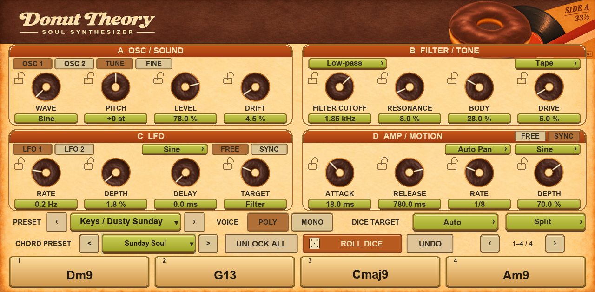
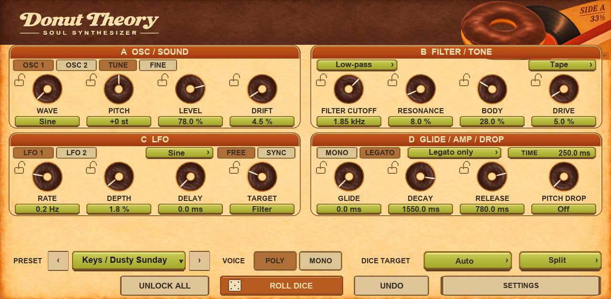
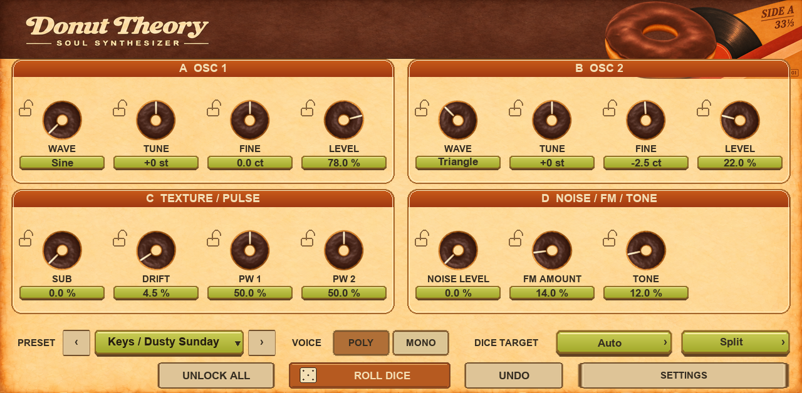
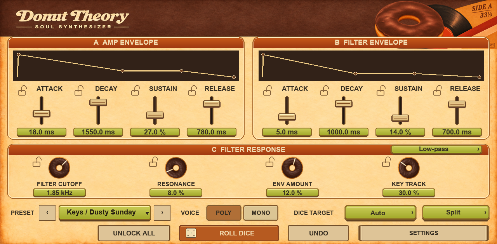
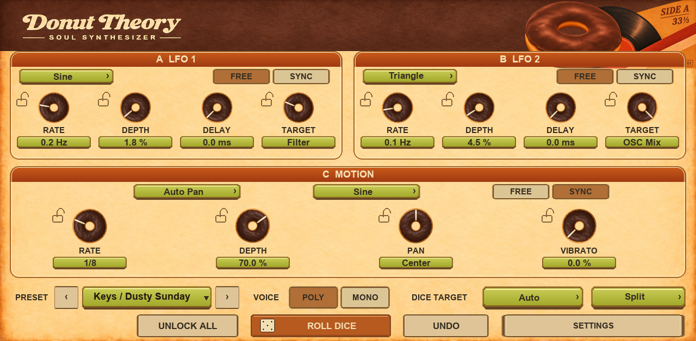
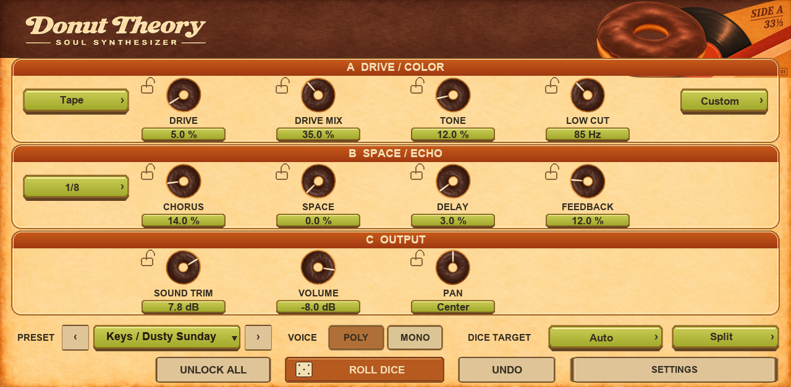
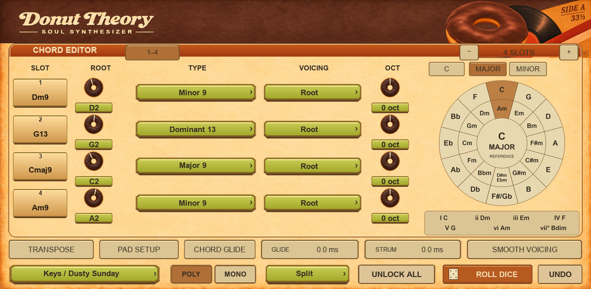

# Donut Theory1.14.0 local implementation evidence

This folder documents the approved shared performance editor implementation. Public/installed version remains1.13.14. No Release, website publication, MPC install or restart was performed.

Offline images are code-rendered skins with one runtime snapshot (Keys / Dusty Sunday), not physical MPC screenshots. `verification.json` records native/ARM/SDK/test and compatibility results and explicit hardware limits. The first353metadata fixture and new performance tests are source-controlled under tests/.

## Offline tab previews

These are approximate renders of the generated runtime TUI, using the same live-engine Keys / Dusty Sunday snapshot. They are not MPC screenshots; the native host header/function keys are outside the628px plugin canvas.

### POLY

### MONO

### OSC

### ENV

### MOD

### FX

### CHORD

## Validation

Native/ARM32/ARM64: pass. SDK validation:0errors/0warnings. Full optimized/UBSan engine/performance/voicing/analog/bridge: pass. Host simulator:19PASS/0WARN/0FAIL. Seven tab map/bounds/modal/asset/hold/choice/unit-range contracts: pass. Exact-normalized Undo passed20UBSan performance runs.3old/new same-state native PCM comparisons and64focus changes have zero sample delta.

`verification.json`, `build.log`, `tests.log` and `native-compatibility.csv` hold evidence. Actual MPC installation/rendering/physical input/hardware audio/CPU/project recall are not verified for1.14.0. Public/device/site remain1.13.14.
